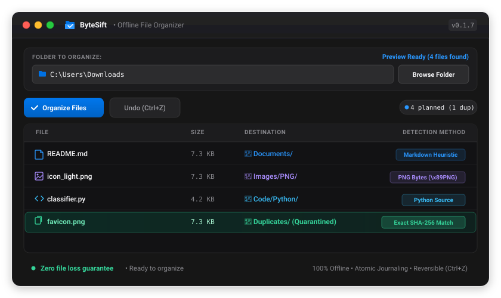
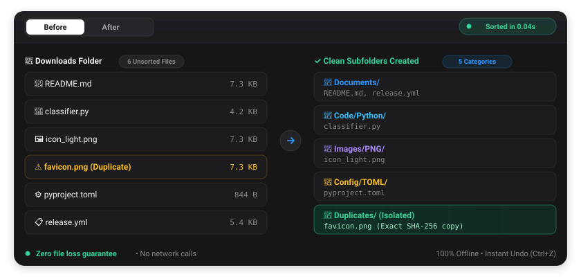

<div align="center">

# ByteSift

**Sort messy folders by what files *actually are*, not what their extensions claim.**

Offline. Deterministic. No AI, no cloud, no telemetry, no dependencies.

[](https://github.com/PramudithaN/bytesift/releases)
[](LICENSE)


[](https://pramudithan.github.io/bytesift/)

[**Download**](https://github.com/PramudithaN/bytesift/releases/latest) ·
[**Website**](https://pramudithan.github.io/bytesift/) ·
[**Interactive demo**](#interactive-demo) ·
[**Quick start**](#quick-start) ·
[**How it works**](#how-it-works)

<br><br>



</div>

---

## 🎬 Interactive Demo

> **"Your unorganized folder, fixed in one click."**

### 1. Before & After

<p align="center">
  
</p>

### 2. Three steps. That is all.

| Step | Action | Description |
|:---:|:---|:---|
| **1** | **Choose a folder** | Pick your Downloads, Desktop, or workspace. ByteSift discovers every file in milliseconds without modifying anything. |
| **2** | **Preview the plan** | ByteSift inspects real content inside each file via magic bytes and text heuristics, flagging identical duplicate copies upfront. |
| **3** | **Organize & Undo** | Click **Organize Files**. Files slot into neat folders instantly. Press <kbd>Ctrl</kbd>+<kbd>Z</kbd> (or `bytesift undo`) anytime to roll back. |

---

## The problem

Your Downloads folder is full of `download`, `file (3).tmp`, `scan_final.bin`, and a PDF someone renamed to `.jpg`. Organizers that sort by extension can't help, because the extension is the part that's wrong.

ByteSift opens each file, reads its first bytes and a small text sample, and decides what it really is. Then it moves it where it belongs. If you don't like the result, one command puts everything back.

## Why ByteSift

| | |
|---|---|
| **Content-aware** | Detects formats from magic bytes, so a mislabeled or extensionless file still lands in the right folder. |
| **Reads documents, not just containers** | Spots invoices, resumes, contracts, source code, and system logs using weighted keyword and structure heuristics. |
| **Fully offline and private** | No network requests, no telemetry, no models. Everything runs locally. |
| **Fully reversible** | Every move is journaled, so `undo` restores your original layout. |
| **Finds duplicates safely** | Size-grouped SHA-256 hashing, so unique files are never needlessly read. |
| **Tiny and fast** | Standard library only, under 30 MB of memory, quick startup. |
| **CLI and desktop GUI** | Native-feeling GUI for macOS and Windows with automatic Dark/Light mode. |

## Install

### Download (no Python needed)

| Platform | Download |
|---|---|
| Windows (recommended) | [ByteSift-Setup-x64.exe](https://github.com/PramudithaN/bytesift/releases/latest/download/ByteSift-Setup-x64.exe) |
| Windows (portable) | [ByteSift-Windows-x64.zip](https://github.com/PramudithaN/bytesift/releases/latest/download/ByteSift-Windows-x64.zip) |
| macOS (Apple Silicon & Intel) | [ByteSift-macOS-Universal.dmg](https://github.com/PramudithaN/bytesift/releases/latest/download/ByteSift-macOS-Universal.dmg) |

Checksums and all versions are on the [Releases page](https://github.com/PramudithaN/bytesift/releases).

### From source

Requires Python 3.9+ and nothing else.

```bash
git clone https://github.com/PramudithaN/bytesift.git
cd bytesift
pip install -e .   # optional: installs the command into your environment
```

## Quick start

**1. Preview first. Nothing is moved.**

```bash
python -m bytesift.cli scan "/path/to/Downloads"
```

**2. Organize.**

```bash
python -m bytesift.cli organize "/path/to/Downloads"
```

**3. Changed your mind? Undo.**

```bash
python -m bytesift.cli undo "/path/to/Downloads"
```

Prefer clicking? Launch the desktop app:

```bash
python -m bytesift.cli gui
```

The GUI lets you pick a folder, preview the plan, run it, and roll back previous actions.

<!-- TODO: add GUI screenshots (light + dark) -->
<!--
<p align="center">
  
  
</p>
-->

## CLI options

For `organize`:

| Option | Description |
|---|---|
| `--yes` | Skip the interactive confirmation prompt. |
| `--strategy [smart\|date\|type]` | Classification mode. Default: `smart`. |
| `--group-by-date` | Add `YYYY-MM` subfolders for media assets. |
| `--no-duplicates` | Disable duplicate detection. |
| `-r`, `--recursive` | Process subdirectories recursively. |
| `--dry-run` | Run the full analysis without changing the file system. |

## How it works

ByteSift classifies each file through a three-tier pipeline and stops at the first confident answer.

```
                    +--------------------+
                    |     Input File     |
                    +---------+----------+
                              |
                              v
                [Tier 1: Magic Byte Inspection]
          Reads initial 16-64 bytes for file signatures
                              |
             +----------------+----------------+
             | Binary Match                    | No Match / Text
             v                                 v
   [Format Identified]           [Tier 2: Text Heuristic Engine]
 (Images, Audio, Archives)        Scans 4-8 KB for keywords/regex
                                               |
                              +----------------+----------------+
                              | Text Match                      | Unmatched
                              v                                 v
                     [Document/Code Type]             [Tier 3: Extension Fallback]
```

1. **Binary magic bytes.** Reads the leading bytes to identify real formats such as Photoshop (PSD/PSB), Blender, After Effects, Premiere Pro, InDesign, Figma, 3D FBX/GLTF, Unity assets, video containers (MP4, MKV, MOV, WebM, WMV, AVI), PDF, JPEG, PNG, ZIP, Office OpenXML, and executables.
2. **Text content heuristics.** Scores a bounded 4-8 KB sample against weighted keyword and structural patterns to recognize invoices, resumes, contracts, CapCut project drafts, Unity YAML scenes/prefabs, DaVinci Resolve timelines, subtitles, playlists, source code, and logs. It is pattern matching, not a language model.
3. **Extension fallback.** Used only when content gives no answer.

Two supporting steps run alongside:

- **Metadata and timestamps.** Embedded timestamps (such as JPEG EXIF) enable chronological archiving.
- **Deduplication.** Files are grouped by size first, and only same-size candidates are hashed with SHA-256. Identical files are routed to a dedicated duplicates folder.

## Security & System Safety Guardrails

ByteSift is engineered to operate safely on host operating systems without risking system stability or exposing files:

- **OS System Directory Protection.** Refuses to organize or modify filesystem drive roots (`C:\`, `/`) or operating system directory trees (`C:\Windows`, `C:\Program Files`, `/etc`, `/bin`, `/usr`).
- **Symlink & Junction Isolation.** Disallows scanning, inspecting, hashing, or moving symbolic links and junction points, eliminating symlink loop Denial-of-Service and out-of-bounds traversal risks.
- **Path Traversal & Rollback Confinement.** Strict boundary checking ensures undo operations cannot be hijacked or poisoned to relocate files outside the target directory.
- **Write-Ahead Logging (WAL) & Crash Resilience.** Move transactions are committed incrementally to an atomic journal with `fsync`, guaranteeing recovery even if power or process termination occurs midway.
- **Decompression Bomb Protection.** ZIP container inspection uses bounded streaming reads (under 2 KB) to prevent Out-Of-Memory (OOM) memory exhaustion from maliciously crafted archives.
- **Collision & TOCTOU Defense.** Targets are verified immediately prior to movement, auto-suffixing candidate names (`filename (1).ext`) to ensure zero accidental file overwrites.
- **Device & EDR Decoy Handling.** Automatically filters Windows reserved device names (`CON`, `PRN`, `AUX`, `NUL`) and anti-ransomware EDR canary bait files.

## Development

Run the test suite:

```bash
python -m unittest discover -s tests -p "test_*.py"
```

Tests cover magic-byte detection across common formats, text heuristics for structured documents and code, security guardrails, collision handling, and rollback.

Build a standalone executable on Windows or macOS:

```bash
python scripts/build.py   # output goes to dist/
```

## Contributing

Contributions are welcome. A good first contribution is adding a new file signature to the magic-byte table or a new text heuristic, each with a test. Please open an issue first for larger changes.

<!-- TODO: add CONTRIBUTING.md and label starter issues "good first issue" -->

## If ByteSift saved you time

A star on the repo helps other people find it. Bug reports and format requests are just as valuable.

## License

[MIT](LICENSE)
